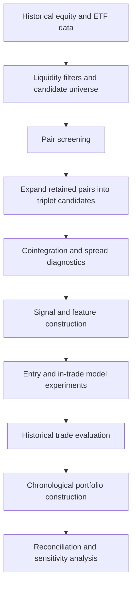

# Research methodology

## Hypothesis

Some securities may exhibit a relationship whose spread is more stable than their individual price paths. A deviation can be investigated as a candidate for mean reversion. Correlation, a low historical p-value or an attractive backtest does not establish a durable trading edge.

## Workflow

This diagram describes the intended research workflow across several modules. It does not certify that every artifact was produced by one consistent, fully causal pipeline.

## Candidate screening: inspected implementation

The weekly notebook loads stock prices, falling back to ETF prices when needed. For each candidate pair it:

1. Joins observations on `date` and `type`.
2. Takes the final 250 merged rows, assuming chronological order.
3. Rejects non-finite or non-positive prices.
4. Requires price-level Pearson correlation of at least 0.70.
5. Applies Johansen estimation to log prices with `det_order=0` and `k_ar_diff=1`.
6. Uses the first eigenvector to construct a weighted log-price spread.
7. Requires a finite, nonzero spread standard deviation and a latest absolute z-score of at least 1.80.

The z-score uses the mean and standard deviation of that selected window. No Johansen trace-significance filter appears in this particular pair-screen function. Broader triplet-search utilities do inspect trace statistics and contain ADF/half-life diagnostics, so the preliminary pair screen must be distinguished from later statistical analysis.

## Triplet expansion

Each retained pair is combined with every other instrument in the universe. In the inspected snapshot:

`1,082 retained pairs × 476 eligible third instruments = 515,032 rows`

The same unordered ticker set can be reached through multiple retained pairs. Deduplication and ordered-leg treatment must be explicit when reporting the number of unique baskets or estimating evaluation workload.

## Features and modelling

The codebase explores rolling-window price and spread statistics, cross-instrument regression/correlation, entropy, mean-reversion half-life and market-context features. Gate notebooks investigate entry selection; continuation and hazard-labelled notebooks investigate in-trade outcomes. Some hazard-labelled code fits a continuation regressor, so filenames should not be interpreted as proof of a deployed hazard classifier.

The audited model-signal dataset has 361 columns, not 361 model inputs. Feature selection, labels, fitted preprocessing and train/test boundaries must be traced for each experiment.

## Historical evaluation

Annual candidate files exist for 2000–2025, with additional 2026 candidate work. This is the coverage of saved research artifacts, not an assertion of a continuous 27-year portfolio backtest. The ML triplet-selection file contains rows for 20 distinct year labels; some years have no rows in that selected artifact.

Seven validation notebooks are labelled 2020–2026. Their supporting annual files overlap in time because pre-entry history and post-entry continuation can cross year boundaries. Summing rows measures storage/workflow scale, not independent sample size.

## Portfolio constraints

Research utilities implement or explore buying-power availability, ticker/pair/sector/industry concentration, PCA concentration diagnostics and checks against opposing ticker signs. Configuration differs between notebook variants. Constraint enforcement must occur at the chronological admission decision and be evaluated jointly with existing positions.

## Validation required before performance publication

An interpretable report needs a frozen universe and configuration, dated information availability, causal features, explicit costs, consistent missing-data treatment, a held-out evaluation protocol and reconciliation between daily and trade-level results. This documentation does not replace that report.
